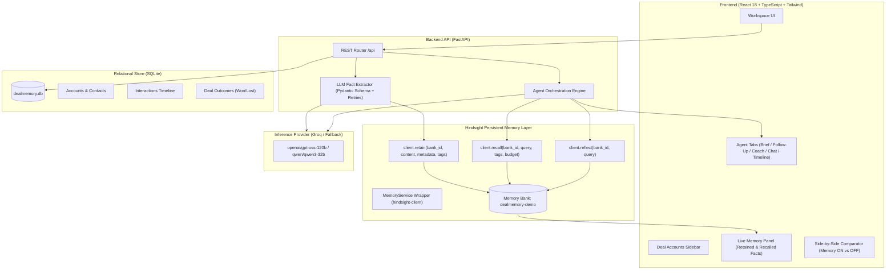

# DealMemory Architecture & System Design

DealMemory is an enterprise deal intelligence agent built around **Hindsight** (Vectorize) as a persistent long-term memory engine.

---

## Component Responsibilities

1. **Frontend Workspace (`frontend/src`)**:
   * **AccountSidebar**: Real-time listing of enterprise deals with stages, deal values, and primary contacts.
   * **Agent Tabs**:
     * `BriefTab`: Synthesizes executive pre-call dossiers grounded in recalled history.
     * `FollowUpTab`: Crafts tailored emails citing exact stakeholder commitments and competitor comparisons.
     * `CoachTab`: Analyzes objections against historical win/loss outcomes across accounts.
     * `ChatTab`: Free-form conversational sales copilot.
     * `TimelineTab`: Chronological interaction history and outcome logging.
   * **MemoryPanel**: Real-time display of recalled memory units with confidence scores, source tags, and timestamps.
   * **CompareModal**: Instant side-by-side execution showing the difference between stateless LLM outputs and Hindsight-augmented generation.

2. **Backend API (`backend/app`)**:
   * **FastAPI Service**: REST orchestration layer with strict schema validation and error isolation.
   * **MemoryService (`app/memory/hindsight_client.py`)**: Thin, resilient wrapper around the official `hindsight-client` Python SDK.
   * **Fact Extractor (`app/agent/extract.py`)**: Parses raw meeting transcripts into discrete business entities with fallback guarantees.
   * **Relational Store (`app/db`)**: SQLite storage for transactional data (accounts, contacts, interactions, outcomes).

3. **Hindsight Memory Primitives**:
   * **Retain**: Stores raw text and structured facts tagged with `account_id`, `type`, and `date`.
   * **Recall**: Multi-strategy TEMPR search across vector embeddings, BM25 keywords, temporal recency, and knowledge graph links.
   * **Reflect**: Synthesizes cross-deal learning to discover high-level win-rate patterns.
